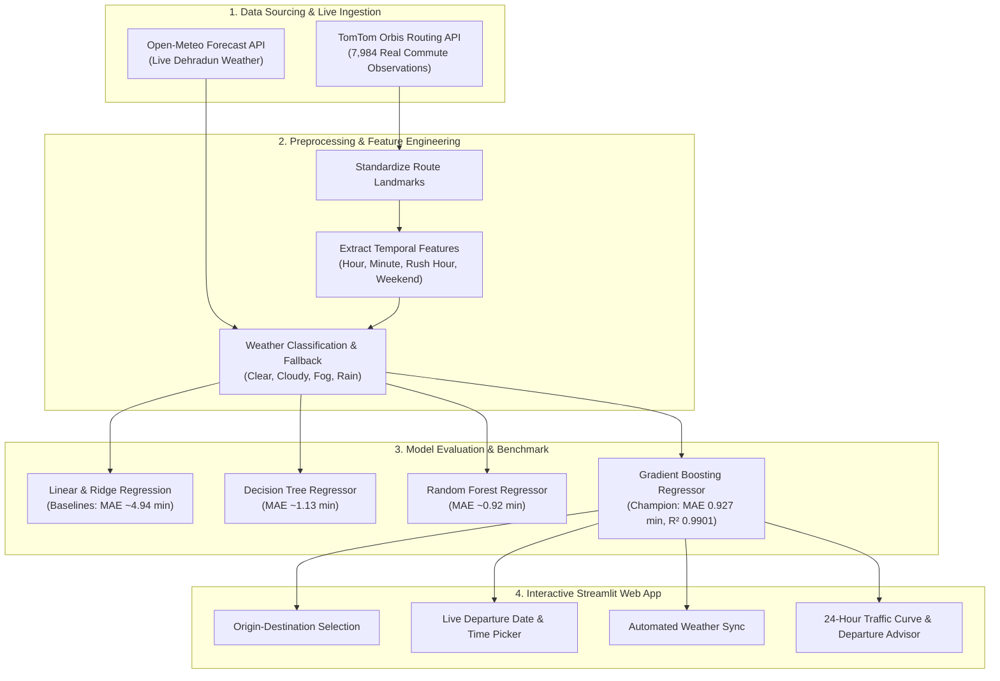
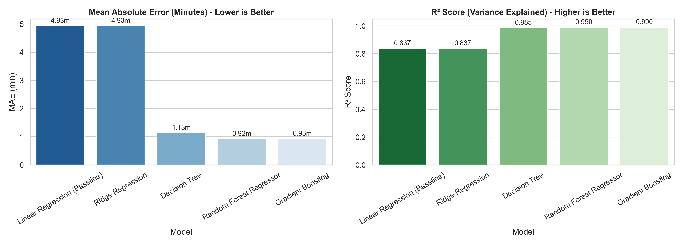
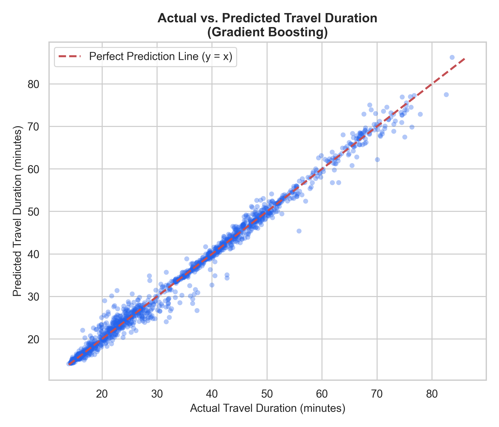
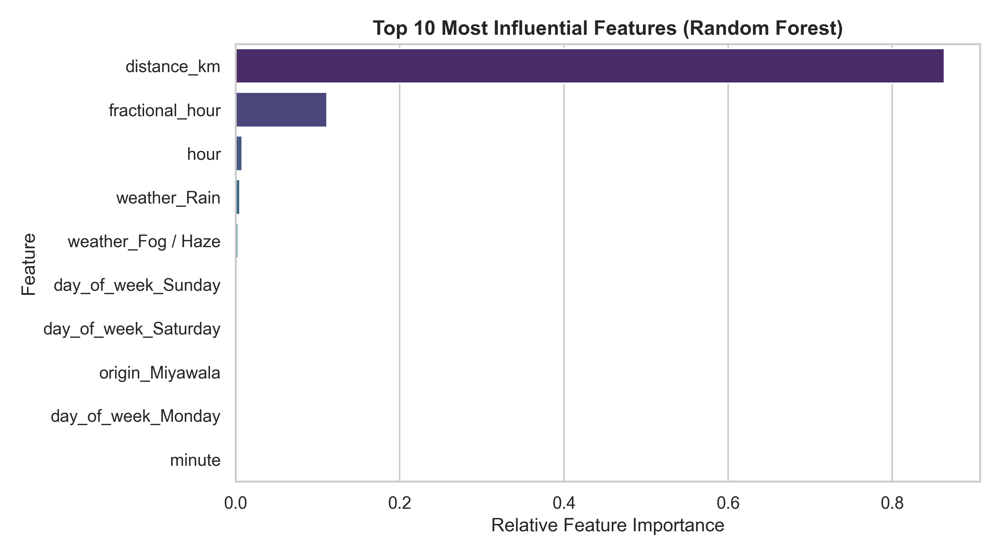
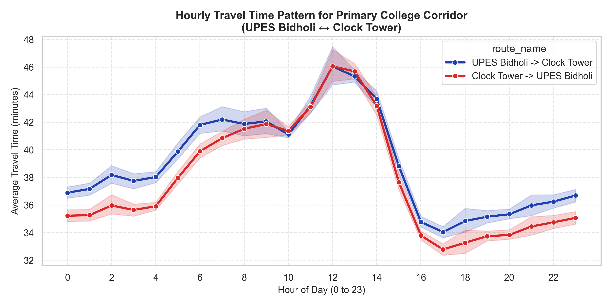
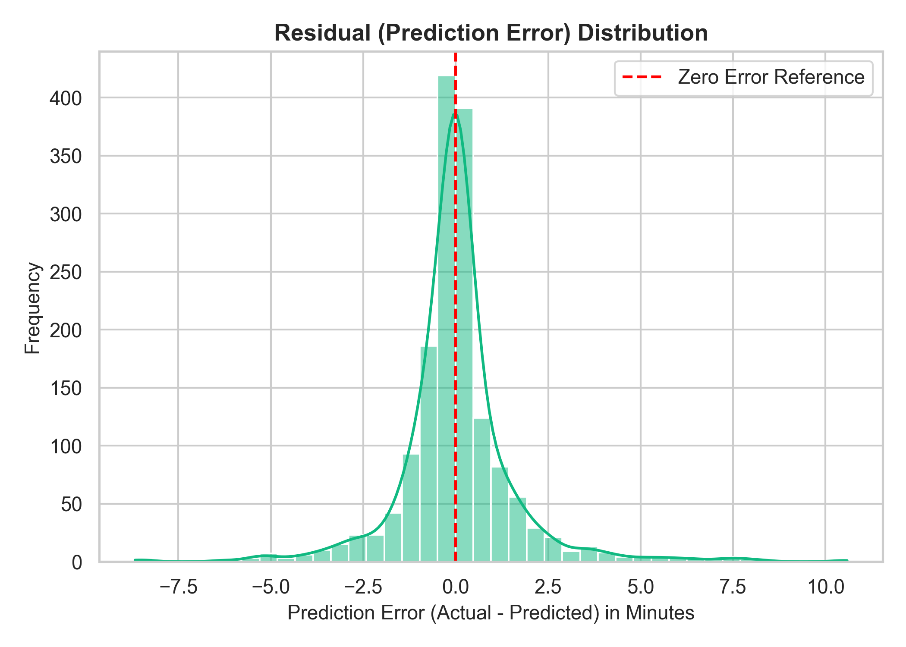

# 🚗 SmartRoute: Travel-Time Prediction for Dehradun Corridors

[](https://www.python.org/)
[](https://streamlit.io/)
[](https://scikit-learn.org/)
[](https://developer.tomtom.com/)
[](https://open-meteo.com/)
[](LICENSE)

> **Machine Learning Semester Project** | **B.Tech CSE (AIML)**  
> **Primary Corridor**: UPES Bidholi ↔ Clock Tower, ISBT Dehradun & Miyawala  

---

## 📑 Table of Contents
- [Project Overview & Problem Statement](#-project-overview--problem-statement)
- [System Architecture](#-system-architecture)
- [Key Features](#-key-features)
- [Supported Routes & Coverage](#-supported-routes--coverage)
- [Model Benchmarks & Evaluation](#-model-benchmarks--evaluation)
- [Visual Analytics & Insights](#-visual-analytics--insights)
- [Quickstart & Installation](#-quickstart--installation)
- [Repository Structure](#-repository-structure)
- [Viva & Presentation Guide](#-viva--presentation-guide)
- [License](#-license)

---

## 📌 Project Overview & Problem Statement

Standard navigation tools provide static snapshots of current traffic. However, when commuters in hilly and semi-urban regions like Dehradun want to answer questions such as:

> *"What will my travel time from UPES Bidholi to ISBT be if I leave at 6:00 PM on a rainy Friday?"*

Static approximations fail because traffic times fluctuate heavily due to:
1. **Temporal Peaks**: College and office rush hours along Premnagar and Chakrata Road (8:00–11:00 AM and 5:00–8:00 PM).
2. **Day-of-Week Patterns**: Commute contrasts between weekdays and weekends.
3. **Foothill Weather Conditions**: Autumn fog/haze, reduced visibility, and monsoon/rain showers causing road slow-downs.
4. **Corridor Topography**: Single-lane chokepoints and mountain transit corridors.

**SmartRoute** addresses this planning challenge by training and evaluating supervised regression pipelines on **7,984 real TomTom Orbis Routing API observations** and serving predictions through a responsive, feature-rich **Streamlit Web Application** integrated with real-time satellite weather forecasting from the **Open-Meteo API**.

---

## 🏗 System Architecture



---

## ✨ Key Features

- **🎯 Sub-Minute Commute Accuracy**: Champion Gradient Boosting model achieves a Mean Absolute Error of **0.927 minutes** ($R^2 = 0.9901$).
- **🌦 Live & Simulated Weather Integration**: Automatically fetches real-time temperature, rain probability, and WMO weather codes for Dehradun via Open-Meteo with offline simulation fallback.
- **📈 24-Hour Congestion Profile**: Simulates dynamic travel times across all 24 hours of the day to identify the fastest travel window and peak bottlenecks.
- **⚠️ Active Traffic Advisories**: Instant contextual alerts classifying traffic status as **Normal Flow**, **Moderate Congestion**, or **Heavy Rush Hour**.
- **📊 Embedded Model Analytics**: Dedicated UI tab displaying parity plots, feature importances, and residual error distributions.

---

## 🗺 Supported Routes & Coverage

SmartRoute covers **12 bidirectional corridors** across four core Dehradun transit hubs:

| Origin Hub | Destination Hub | Nominal Distance (km) | Typical Off-Peak Duration |
| :--- | :--- | :---: | :---: |
| **UPES Bidholi** | Clock Tower | 14.63 km | ~25–30 min |
| **UPES Bidholi** | ISBT Dehradun | 19.32 km | ~35–45 min |
| **UPES Bidholi** | Miyawala | 23.17 km | ~45–60 min |
| **Clock Tower** | UPES Bidholi | 15.53 km | ~25–30 min |
| **Clock Tower** | ISBT Dehradun | 6.98 km | ~15–20 min |
| **Clock Tower** | Miyawala | 9.25 km | ~20–25 min |
| **ISBT Dehradun** | UPES Bidholi | 19.06 km | ~35–45 min |
| **ISBT Dehradun** | Clock Tower | 7.13 km | ~15–20 min |
| **ISBT Dehradun** | Miyawala | 10.94 km | ~20–30 min |
| **Miyawala** | UPES Bidholi | 24.67 km | ~45–60 min |
| **Miyawala** | Clock Tower | 8.98 km | ~20–25 min |
| **Miyawala** | ISBT Dehradun | 10.99 km | ~20–30 min |

---

## 🏆 Model Benchmarks & Evaluation

All models were evaluated on an independent 20% holdout test set (1,597 unseen observations):

| Model Architecture | MAE (min) ↓ | RMSE (min) ↓ | $R^2$ Score ↑ | MAPE (%) ↓ | Performance Summary |
| :--- | :---: | :---: | :---: | :---: | :--- |
| **Linear Regression** | 4.935 | 6.384 | 0.8372 | 16.32% | Fails to capture non-linear congestion surges |
| **Ridge Regression** | 4.935 | 6.383 | 0.8372 | 16.32% | Regularized linear baseline |
| **Decision Tree Regressor** | 1.133 | 1.912 | 0.9854 | 3.69% | Strong partitioning of rush-hour thresholds |
| **Random Forest Regressor** | **0.920** | 1.612 | 0.9896 | **2.98%** | Superior variance reduction through bagging |
| **Gradient Boosting (Champion)** | 0.927 | **1.575** | **0.9901** | 3.03% | **Lowest RMSE and highest overall variance explained** |

> **Key Takeaway**: Ensemble tree-based models drastically outperform linear models, reducing prediction error by **over 81%** (from ~4.94 min to ~0.92 min).

---

## 📈 Visual Analytics & Insights

The repository includes high-resolution evaluation figures automatically generated during the training phase (`reports/figures/`):

### 1. Cross-Model Benchmark Comparison
Comparison of Mean Absolute Error (MAE) and $R^2$ score across all tested algorithms:
<p align="center">
  
</p>

### 2. Actual vs. Predicted Parity Plot
The champion Gradient Boosting model shows tight alignment along the identity diagonal ($y = x$):
<p align="center">
  
</p>

### 3. Feature Importance Ranking
Identifies the key factors influencing travel times in Dehradun corridors:
<p align="center">
  
</p>

### 4. 24-Hour Diurnal Congestion Waves
Visualizes peak morning (8:00–11:00 AM) and evening (5:00–8:00 PM) rush hours:
<p align="center">
  
</p>

### 5. Residuals Distribution
The error distribution is sharply centered at zero with narrow tails, confirming unbiased predictions:
<p align="center">
  
</p>

---

## 🚀 Quickstart & Installation

Follow these steps to run the SmartRoute web application locally:

### 1. Clone the Repository
```bash
git clone https://github.com/Vaishnaviidobhal/Smart_route_Traveltimeprediction.git
cd Smart_route_Traveltimeprediction
```

### 2. Set Up a Virtual Environment (Recommended)
```bash
# Windows
python -m venv venv
.\venv\Scripts\activate

# macOS / Linux
python3 -m venv venv
source venv/bin/activate
```

### 3. Install Dependencies
```bash
pip install -r requirements.txt
```

### 4. Launch the Streamlit Application
```bash
streamlit run app.py
```
The application will launch in your default web browser at `http://localhost:8501`.

### 5. (Optional) Re-Train the ML Pipeline
To re-run data preprocessing and benchmark all models:
```bash
python -m src.preprocess
python -m src.train
```

---

## 📁 Repository Structure

```
Smart_route_Traveltimeprediction/
├── app.py                                     # Interactive Streamlit GUI Web Application
├── requirements.txt                           # Project dependencies
├── smartroute_traffic.csv                     # Raw TomTom API observations (7,984 rows)
├── SmartRoute_Travel_Time_Prediction_Presentation.pptx # Project viva slides
├── README.md                                  # Documentation and benchmark reports
│
├── data/
│   └── cleaned_traffic_data.csv               # Preprocessed and engineered dataset
│
├── models/
│   ├── smartroute_best_model.pkl              # Champion serialized ML pipeline (Gradient Boosting)
│   └── model_metadata.json                    # Feature schemas, distance lookup & evaluation metrics
│
├── reports/
│   └── figures/                               # Exported evaluation figures & diagnostic plots
│       ├── actual_vs_predicted.png
│       ├── feature_importance.png
│       ├── hourly_congestion_profile.png
│       ├── model_comparison.png
│       └── residuals_distribution.png
│
└── src/
    ├── preprocess.py                          # Data cleaning, weather synthesis & feature engineering
    ├── train.py                               # Model benchmarking, cross-validation & artifact export
    ├── predict.py                             # Inference class & 24-hr batch curve generator
    └── weather_service.py                     # Live Open-Meteo satellite weather API integration
```

---


